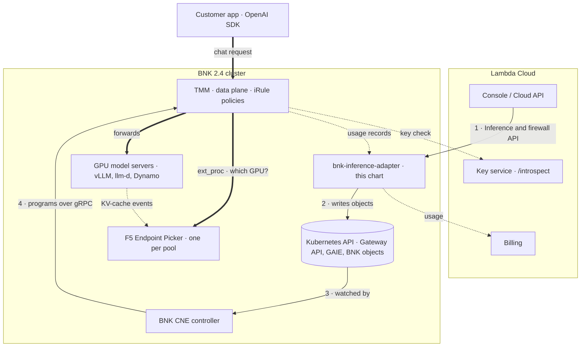
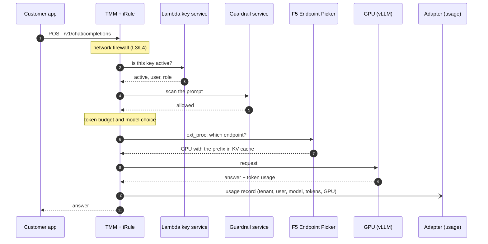
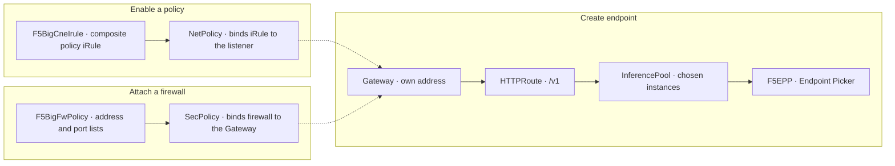

# Lambda Inference Gateway on F5 BIG-IP Next for Kubernetes: adoption kit

This kit is for the engineers who would integrate the Inference Gateway into Lambda Cloud. It contains the
API contracts, the Helm chart for the integration service, and a description of the Kubernetes objects
behind each API call.

Rendered overview: open `index.html`, or the GitHub Pages site for this repository.

## What's in the kit

| Path | Contents |
|---|---|
| `contracts/inference-gateway.openapi.yaml` | Inference Gateway API (OpenAPI 3.1): endpoints, policies, usage, utilization, benchmarks |
| `contracts/network-firewall.openapi.yaml` | Network firewall API (OpenAPI 3.1): policies, address and port lists, log destinations, events |
| `chart/` | Helm chart for `bnk-inference-adapter`, the service that implements both APIs |
| `docs/bnk-objects.md` | The BNK and Gateway API objects created for each endpoint and policy |
| `docs/api-walkthrough.sh` | The full flow with `curl` only: create an endpoint, enable each policy, chat, read usage, delete |
| `docs/topology.html` | Interactive topology of the reference lab |

Both contracts follow Lambda Cloud API v1.10.0 conventions: Bearer keys, `{"data": ...}` and
`{"error": {...}}` envelopes, and `-operations` paths for actions.

## How it works

- The adapter is the only new service. It needs the Kubernetes API and the BNK 2.4, Gateway API and
  Gateway API Inference Extension CRDs. It never connects to TMM.
- Each inference endpoint gets its own Gateway and address, HTTPRoute, InferencePool with an F5 Endpoint
  Picker, and one iRule built from the endpoint's enabled policies: API keys, guardrails, token quotas,
  model schedule and metering.
- Request path: client → TMM (iRule policies) → Endpoint Picker → GPU. The console and API are not in the
  request path. TMM calls back to Lambda only for the key check and to send usage records.

## Diagrams

### Architecture: control path and request path



### One chat request



### API calls to BNK objects



## Install

Prerequisites on the target cluster:

- BNK 2.4 with the Gateway API and Gateway API Inference Extension CRDs, and a GatewayClass for your
  CNEInstance.
- The endpoint namespace listed in `CNEInstance.spec.eppNamespaces` and holding the F5 registry pull
  secret.
- Model-server pods labelled `lambda.ai/instance` and `lambda.ai/role`. See `docs/bnk-objects.md`.

```sh
helm install bnk-inference-adapter ./chart -n lambda-ie \
  --set config.AUTH_INTROSPECT_URL=http://<your key service>/introspect \
  --set config.USAGE_COLLECTOR_ADDR=<adapter service ip>:5514
```

Every setting is documented in `chart/values.yaml`. The key service has one contract:

```
POST /introspect  {"token": "<key>"}
→ 200 {"active": true, "sub": "<user>", "role": "admin"|"member"}   or   200 {"active": false}
```

## See it running

The reference lab runs this integration on a live BNK 2.4 cluster with NVIDIA GPUs, alongside a replica of
the Lambda console.

The last challenge, **07 · How Lambda would ship this**, is the integration view. It shows the contracts,
the Helm chart values, the rendered iRule and the BNK objects behind a live endpoint. To go straight to it:

1. Start the track and wait for the sandbox to finish setting up.
2. Press **Skip** on each challenge until you reach challenge 07. Skipping a challenge completes its
   steps automatically, so the endpoint used in challenge 07 is created along the way.
3. In challenge 07, use the **Lambda Console** tab (Inference Gateway → Adopt), the **Topology** tab, and
   the terminal commands in the challenge text.

If no GPU is available when the sandbox starts, the lab uses clearly labelled simulated instances. That
doesn't affect challenge 07, which is about the integration rather than performance.

## Versions

| Component | Version |
|---|---|
| F5 BIG-IP Next for Kubernetes | 2.4 |
| Gateway API Inference Extension | v1 (`inference.networking.k8s.io/v1`) |
| Adapter and chart | 0.1.0 |

The chart is licensed under Apache 2.0.
